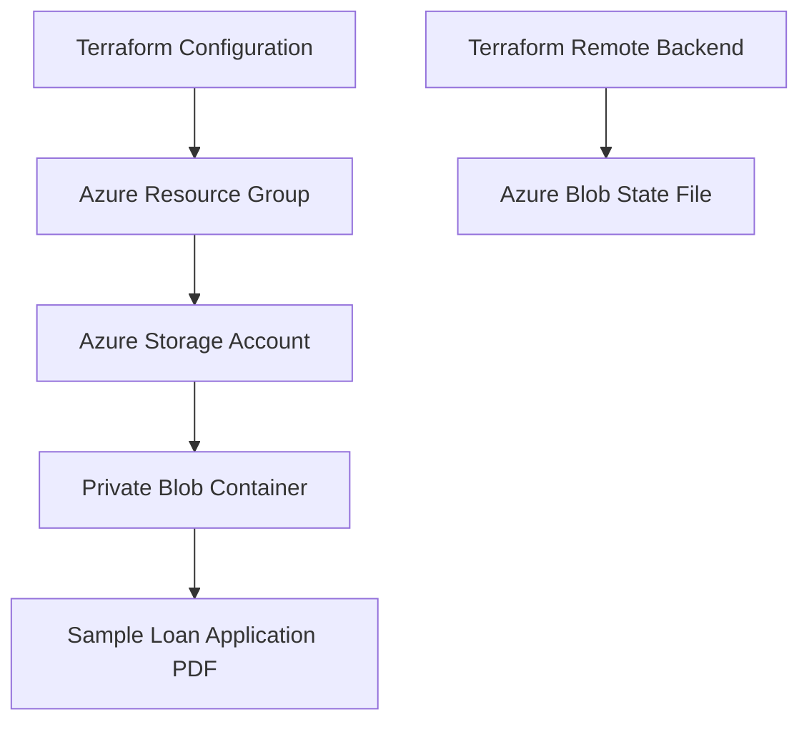
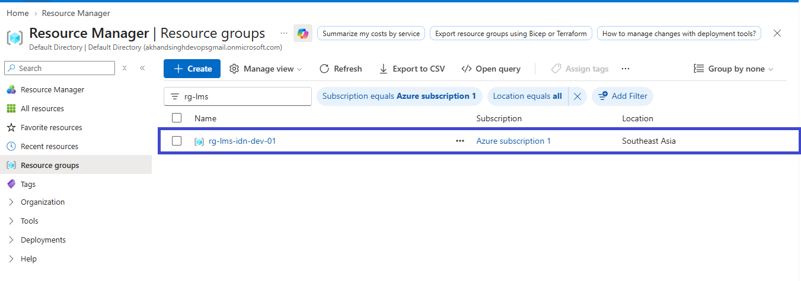
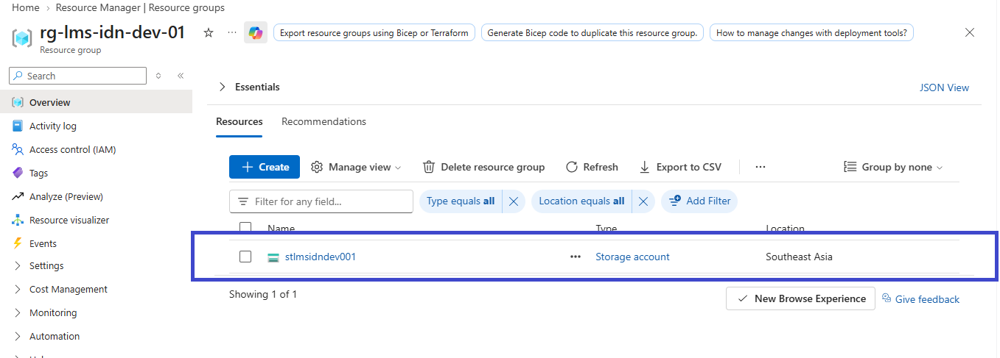
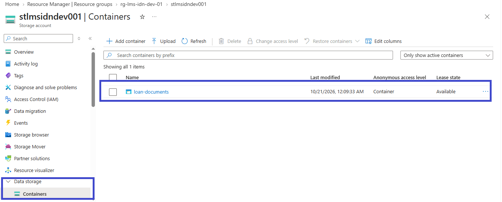

# Azure Infrastructure | Indonesia Loan Management System


## Project Overview

This repository contains Terraform configuration for provisioning and managing Azure infrastructure for an Indonesia Loan Management System development environment.

The project demonstrates Infrastructure as Code (IaC), Azure Storage configuration, Terraform state management, and infrastructure documentation.

## Architecture



## Azure Resources

| Resource | Configuration |
|---|---|
| Resource Group | `rg-lms-idn-dev-01` |
| Storage Account | `stlmsidndev001` |
| Region | Southeast Asia |
| Performance Tier | Standard |
| Replication | GRS |
| Blob Container | `loan-documents` |
| Container Access | Private |
| Sample Blob | `loan-application-sample.pdf` |

## Technologies Used

- Microsoft Azure
- Terraform
- Azure Blob Storage
- Terraform AzureRM Provider
- Git and GitHub
- Visual Studio Code
- PowerShell

## Terraform Remote Backend

Terraform supports storing infrastructure state remotely in Azure Blob Storage.

**Backend configuration currently intended for this project:**

| Setting | Value |
|---|---|
| Backend Type | `azurerm` |
| Resource Group | `rg-lms-idn-dev-01` |
| Storage Account | `stlmsidndev001` |
| Container | `loan-documents` |
| State File Key | `dev.terraform.tfstate` |

### Backend Initialization

```powershell
terraform init
```

If migrating existing local state to the configured remote backend:

```powershell
terraform init -migrate-state
```

Validate and review infrastructure changes:

```powershell
terraform validate
terraform plan
```

> **Security note:** Terraform state may contain sensitive information. A dedicated private container named `tfstate` is recommended instead of reusing the application document container. Confirm the backend resources and required permissions before initialization.

## Infrastructure Screenshots

### 1. Resource Group



### 2. Storage Account



### 3. Private Blob Container



### 4. Sample PDF Blob


## Key Learning Outcomes

- Provisioning Azure infrastructure with Terraform.
- Understanding Terraform providers, resources, and state.
- Configuring Azure Storage Accounts and private Blob Containers.
- Learning the purpose of a remote backend.
- Validating infrastructure configuration and reviewing execution plans.
- Managing infrastructure code using Git and GitHub.

## Future Enhancements

- Use a dedicated private container for Terraform state.
- Organize reusable Terraform child modules.
- Add environment-specific variable files.
- Integrate Terraform with Azure DevOps CI/CD pipelines.
- Add monitoring, logging, and deployment approvals.

## Author

**Sharanjeet Kaur**

Cloud & DevOps | Microsoft Azure | Terraform | Azure DevOps

## Tags

`#Azure` `#Terraform` `#InfrastructureAsCode` `#IaC` `#AzureDevOps` `#DevOps` `#CloudInfrastructure`
