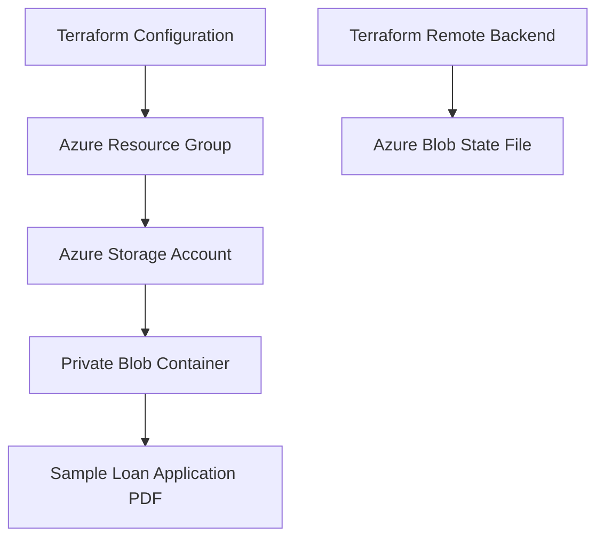
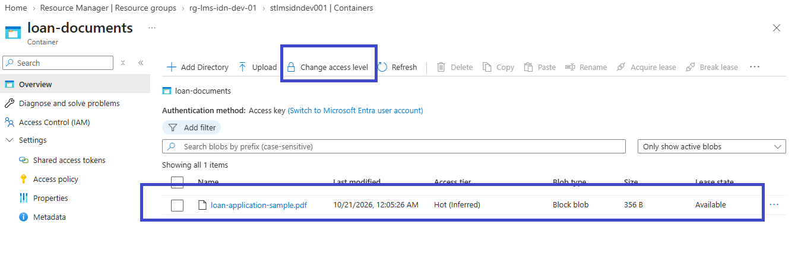

# Azure Infrastructure | Indonesia Loan Management System

[](https://www.google.com/search?q=Microsoft+Azure+Cloud+Infrastructure)  [](https://www.google.com/search?q=Terraform+Infrastructure+as+Code)  [](https://www.google.com/search?q=GitHub+Version+Control)

## Project Overview

This repository documents the Azure infrastructure for an Indonesia Loan Management System development environment.

The project focuses on Infrastructure as Code (IaC), Terraform configuration, Azure resource provisioning, remote state management, and infrastructure documentation.

## Architecture



## Azure Resources

| Resource | Configuration |
|---|---|
| Resource Group | `rg-lms-idn-dev-01` |
| Storage Account | `stlmsidndev001` |
| Region | Southeast Asia |
| Performance Tier | Standard |
| Replication | GRS |
| Blob Container | `loan-documents` |
| Container Access | Private |
| Sample Blob | `loan-application-sample.pdf` |

## Technologies Used

- Microsoft Azure
- Terraform
- Azure Blob Storage
- Terraform AzureRM Provider
- Git and GitHub
- Visual Studio Code
- PowerShell

## Terraform Architecture: Parent-Child Modular Approach

The overall project is organized into separate Terraform repositories for different Azure infrastructure components.

- `terraform-azure-resource-group` — Resource Group infrastructure
- `terraform-azure-storage-account` — Storage Account infrastructure
- `terraform-azure-container` — Blob Container infrastructure
- `terraform-azure-blob` — Blob infrastructure
- `terraform-azure-infrastructure` — Project documentation and screenshots

### Reusable Modules and `for_each`

The intended modular design uses parent configurations to pass variables to reusable child modules. Terraform's `for_each` can create multiple resource or module instances from map-based configuration without repeating the same blocks.

**Benefits:**
- Reusable and maintainable Terraform code
- Reduced code duplication
- Centralized configuration through variables
- Consistent infrastructure deployments
- Easier expansion to multiple environments

*Note: Separate repositories do not automatically call one another as child modules. The parent-child relationship and `for_each` should be described as implemented only where the Terraform code actually uses them.*

## Terraform Remote Backend

Terraform can store its state remotely in Azure Blob Storage instead of keeping it only on the local machine.

### Intended Backend Configuration

| Setting | Value |
|---|---|
| Backend Type | `azurerm` |
| Resource Group | `rg-lms-idn-dev-01` |
| Storage Account | `stlmsidndev001` |
| Container | `loan-documents` |
| State File Key | `dev.terraform.tfstate` |

### Initialize Terraform

```powershell
terraform init
```

To migrate existing local state to the configured remote backend:

```powershell
terraform init -migrate-state
```

Validate and review the configuration:

```powershell
terraform validate
terraform plan
```

**Security note:** Terraform state may contain sensitive information. A dedicated private container such as `tfstate` is recommended instead of reusing the application document container. Ensure the backend resources and required permissions exist before initialization.

## Infrastructure Screenshots

### 1. Azure Resource Group


### 2. Azure Storage Account


### 3. Private Blob Container


### 4. Uploaded PDF Blob



## Key Learning Outcomes

- Understanding Azure Resource Groups and Storage Accounts
- Working with Terraform resources, variables, and state
- Learning reusable module design and `for_each`
- Configuring private Blob Containers
- Understanding Terraform remote backend concepts
- Reviewing infrastructure changes using `terraform plan`
- Managing infrastructure code through Git and GitHub

## Future Enhancements

- Configure a dedicated private container for Terraform state
- Expand reusable Terraform modules
- Introduce environment-specific variable files
- Integrate Terraform with Azure DevOps CI/CD pipelines
- Add monitoring, logging, and deployment approvals

